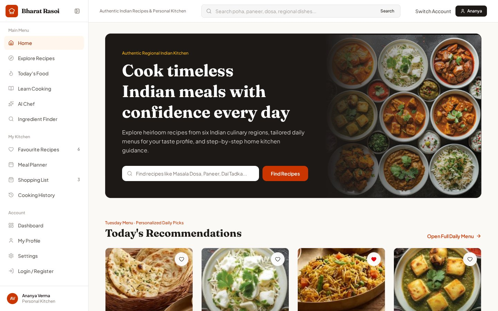
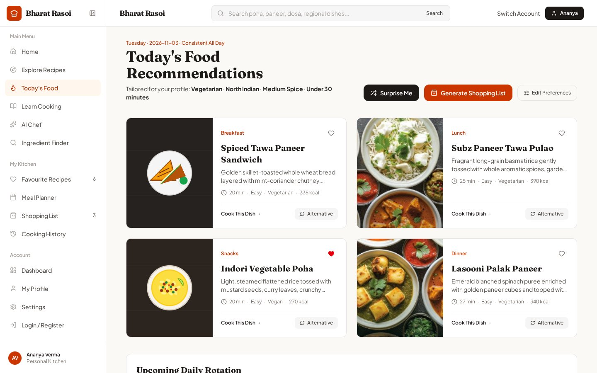
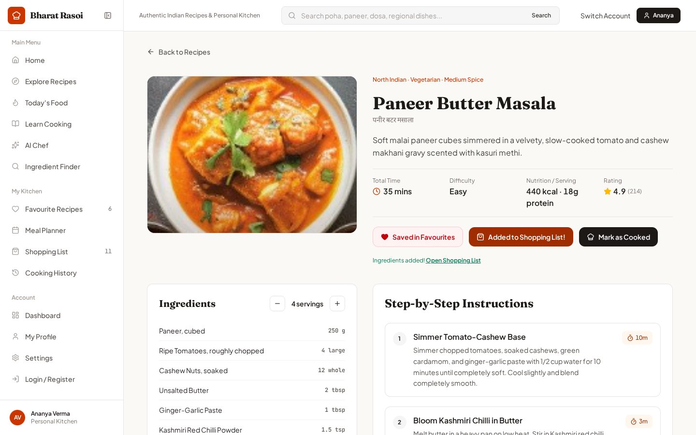
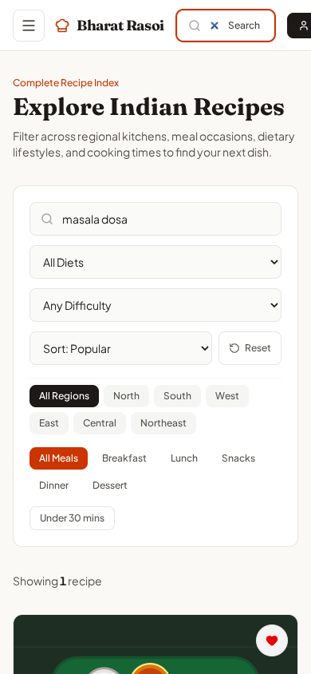
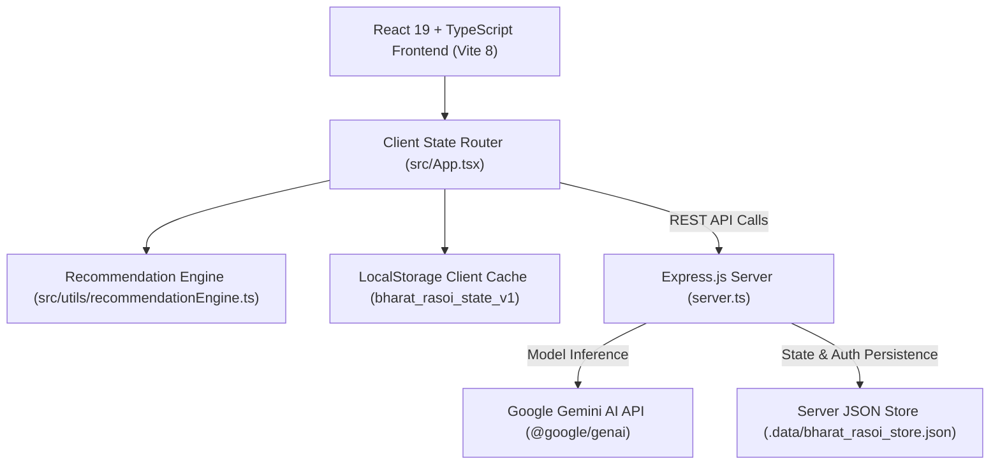

# 🍲 Bharat Rasoi (भारत रसोई) — Intelligent Indian Culinary & AI Kitchen Platform

> **A modern, full-stack Indian culinary platform combining regional heritage with generative AI — featuring a Google Gemini-powered AI Chef, automated 4-meal daily scheduling, fridge-ingredient matching, and weekly grocery logistics.**

[](https://react.dev/)
[](https://www.typescriptlang.org/)
[](https://vitejs.dev/)
[](https://tailwindcss.com/)
[](https://ai.google.dev/)
[](LICENSE)

---

## 📸 Visual Showcase & UI Gallery

| 🏠 Home & Regional Discovery | 🍱 Today's 4-Meal Recommendation Board |
| :---: | :---: |
|  |  |

| 📖 Step-by-Step Recipe & Timers | 📱 Mobile Responsive Interface |
| :---: | :---: |
|  |  |

---

## 🌟 Key Highlights

- **🤖 Google Gemini AI Chef with Offline Fallback:** Live conversational culinary assistance with personalized dietary awareness. Runs via Google Gemini API, with an intelligent built-in fallback engine if no API key is configured.
- **🍛 Authentic 6-Region Coverage:** Hand-curated authentic recipes covering **North, South, East, West, Central, and North-East India**.
- **🍱 Intelligent Daily Meal Planner:** Generates breakfast, lunch, snacks, and dinner schedules aligned with dietary restrictions (Vegetarian, Vegan, Jain, Gluten-Free, Diabetic-Friendly).
- **🥕 "What's in My Fridge?" Pantry Matching:** Multi-ingredient search algorithm that pinpoints dishes cookable with on-hand ingredients.
- **🛒 Weekly Kitchen Planner & Smart Grocery List:** Auto-categorized by supermarket aisles (Produce, Dairy, Spices, Grains) with dynamic ingredient scaling.
- **📚 Culinary Masterclasses & Masala Blends:** Step-by-step guides for signature Indian spice mixtures (*Garam Masala*, *Sambhar Podi*, *Panch Phoron*) and foundational techniques (*Tadka*, *Bhunao*, *Dum*).

---

## 🏗️ System Architecture



---

## ✨ Feature Deep Dive

### 1. 🤖 Conversational AI Chef
The AI Chef acts as your sous-chef in the kitchen:
- **Dietary & Allergy Guardrails:** Respects user preferences (e.g., strictly avoids peanuts or onion-garlic for Jain diets).
- **Culinary Troubleshooting:** Instant advice on balancing over-salted curries, sour gravies, or softening hard paneer.
- **Automatic Grocery Suggestions:** Extracted ingredients mentioned in conversations can be added to your shopping list with a single click.

### 2. 🍱 Daily 4-Meal Recommendation System
- Calculates unique **Preference Signatures** (Diet + Spice Level + Time Constraints + Regional Preferences).
- Prevents meal fatigue by rotating recommendations across consecutive days.
- Supports **Instant Slot Swaps** to replace individual meals while preserving the daily nutrition balance.

### 3. ⚖️ Interactive Recipe Execution Engine
- **Fractional Servings Scaling:** Mathematical recalculation of ingredient amounts when adjusting serving counts.
- **Interactive Checklists:** Cross off ingredients as you prep.
- **Integrated Timers:** Embedded countdown timers for simmering, pressure cooking, and resting.
- **Nutritional Transparency:** Breakdown of calories, protein, carbs, fats, and fiber per portion.

---

## 🔌 Backend API Reference

The backend runs on Express with typed REST endpoints:

| Method | Endpoint | Description |
|---|---|---|
| `POST` | `/api/ai-chef` | Processes queries with Gemini AI (or built-in fallback) with conversational context |
| `POST` | `/api/auth/register` | Creates a new user profile with input validation |
| `POST` | `/api/auth/login` | Authenticates users against the secure local store |
| `GET` | `/api/state/:userId` | Retrieves synced kitchen state (pantry, planner, favorites) |
| `POST` | `/api/state/:userId` | Persists user kitchen changes to server store |

### 🔑 Demo Account Credentials
For instant preview and testing, pre-configured demo credentials are provided:
- **Email:** `ananya.verma@bharatrasoi.in`
- **Password:** `rasoi123`

*(You can also register a new account anytime via the UI.)*

---

## 🛠️ Technology Stack

| Layer | Tools & Libraries |
|---|---|
| **Frontend Framework** | React 19 (`react`, `react-dom`) |
| **Language & Tooling** | TypeScript 5.x, Vite 8, `tsx` |
| **Styling & Design System** | Tailwind CSS v4, Custom CSS Variables |
| **Motion & Micro-interactions** | `motion` (Framer Motion v12) |
| **Iconography** | Lucide React (`lucide-react`) |
| **AI / Machine Learning** | Google GenAI SDK (`@google/genai`) — Gemini Flash |
| **Backend & Runtime** | Node.js, Express 4.x, Bun runtime compatible |

---

## 🚀 Quick Start Guide

### Prerequisites
- **Node.js** (v18.0.0 or higher) or **Bun**
- Modern Web Browser (Chrome, Edge, Firefox, Safari)

### 1. Clone & Navigate
```bash
git clone https://github.com/vaidiksingh54-web/rasoi.git
cd rasoi
```

### 2. Install Dependencies
```bash
# Using bun (recommended)
bun install

# Or using npm
npm install
```

### 3. Setup Environment Variables
Create a `.env` file in the root folder:
```env
GEMINI_API_KEY=your_gemini_api_key_here
PORT=3000
```
> **Note:** Even without a `GEMINI_API_KEY`, Bharat Rasoi's **Integrated Fallback AI Chef** will automatically handle cooking queries with curated culinary advice.

### 4. Launch the Development Server
```bash
# Using bun
bun run dev

# Or using npm
npm run dev
```

Visit `http://localhost:3000` in your browser.

---

## 📁 Repository Structure

```
rasoi/
├── docs/
│   └── screenshots/        # High-resolution application screenshots
├── public/                 # Static assets & web icons
├── src/
│   ├── components/         # Reusable UI components
│   │   ├── Header.tsx      # Global search, profile badge & notifications
│   │   ├── Sidebar.tsx     # Collapsible navigation drawer
│   │   ├── RecipeCard.tsx  # Dynamic dish card with badges & tags
│   │   ├── DishVisual.tsx  # Visual food presentation component
│   │   └── Footer.tsx      # Platform footer & cultural links
│   ├── data/
│   │   └── recipes.ts      # Pan-Indian recipe database & initial seed state
│   ├── pages/              # Primary view controllers
│   │   ├── HomePage.tsx            # Curated hero, trending dishes & quick filters
│   │   ├── ExploreRecipesPage.tsx  # Multi-faceted search, cuisine & diet filtering
│   │   ├── TodaysFoodPage.tsx      # Daily 4-meal recommendation board
│   │   ├── RecipeDetailsPage.tsx   # Step-by-step cooking view with timers
│   │   ├── AIChefPage.tsx          # Google Gemini AI conversational chef
│   │   ├── IngredientFinderPage.tsx# Pantry ingredient matching engine
│   │   ├── KitchenToolsPages.tsx   # Meal planner & categorized grocery checklist
│   │   ├── LearnCookingPage.tsx    # Spices masterclass & regional techniques
│   │   ├── FavouritesPage.tsx      # Bookmarked recipe library
│   │   ├── ProfilePage.tsx         # Dietary profile & taste preferences
│   │   └── AccountAndAuthPages.tsx # Authentication modal & account settings
│   ├── utils/
│   │   ├── recommendationEngine.ts # Preference signature calculation & meal rotation
│   │   └── recommendationEngine.test.ts # Unit tests for recommendation logic
│   ├── types.ts            # TypeScript interfaces & domain data models
│   ├── App.tsx             # Master client state & route switcher
│   ├── main.tsx            # Application entrypoint
│   └── index.css           # Tailwind CSS directives
├── server.ts               # Express backend & Gemini API integration
├── vite.config.ts          # Vite build config with Tailwind v4 & React plugins
├── tsconfig.json           # Strict TypeScript configuration
└── package.json            # Project dependencies & execution scripts
```

---

## 🧪 Testing

Run recommendation engine unit tests:
```bash
bun test
# or
npm test
```

---

## 📄 License

This project is licensed under the **MIT License** — see the [LICENSE](LICENSE) file for details.

---

<p align="center">
  Crafted with ❤️ for Indian culinary heritage and modern AI-driven kitchens.
</p>
